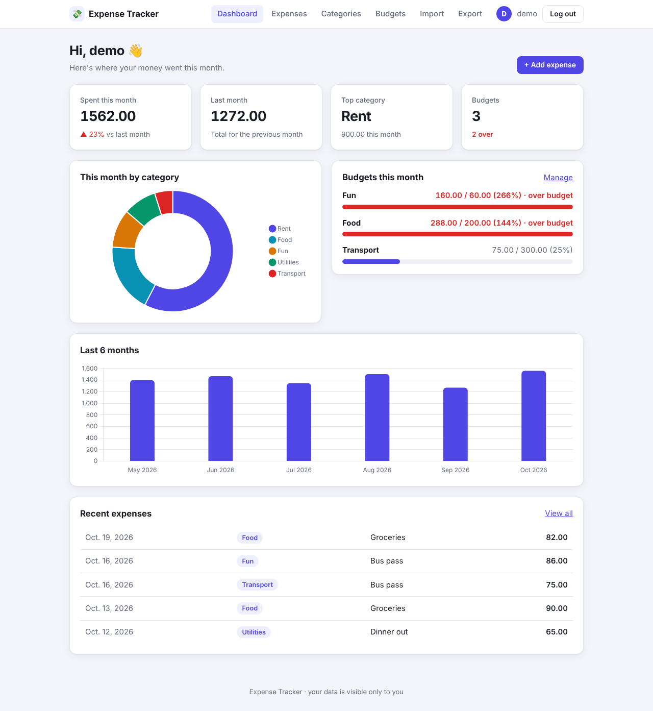
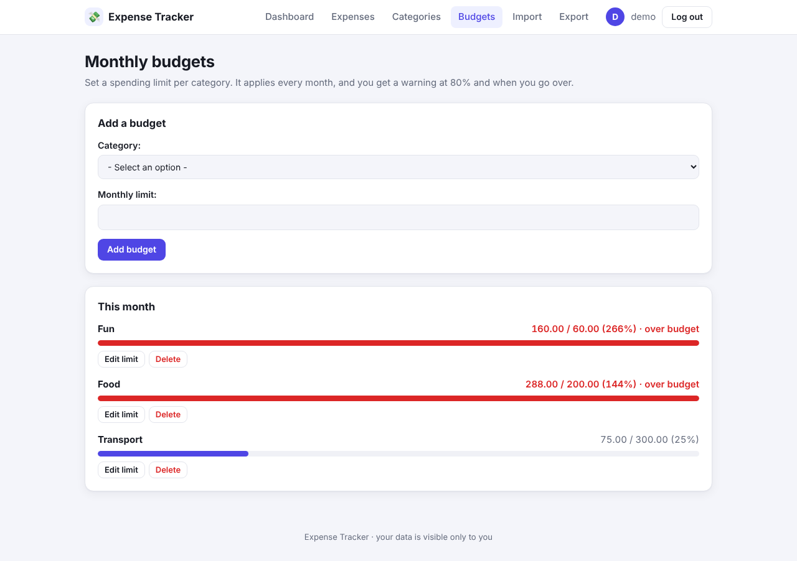
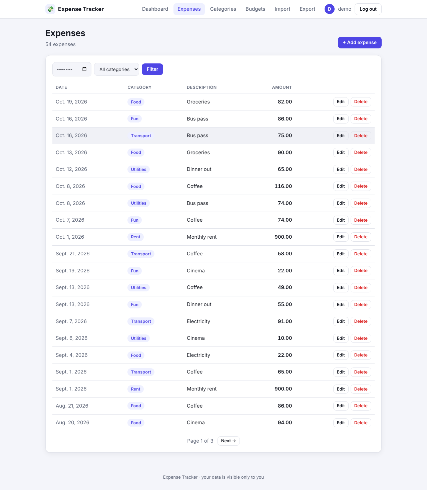

# Expense Tracker

[](https://github.com/ChakshitGaur/expense-tracker/actions/workflows/tests.yml)
[](https://github.com/ChakshitGaur/expense-tracker/actions/workflows/deploy.yml)

A multi-user Django app to log expenses, organise them by category, and see where the money goes, with a charts dashboard and CSV import/export.



<details>
<summary>More screenshots</summary>





</details>

*Screenshots use made-up demo data.*

## Features
- **Accounts:** sign up and log in; every user sees only their own data (other users' records return 404)
- **Expenses:** add, edit and delete; filter by month and category; paginated list
- **Categories:** personal categories per user (case-insensitive, no duplicates)
- **Monthly budgets:** set a limit per category; progress bars on the dashboard turn amber at 80% and red when you go over, and adding an expense that crosses a threshold shows a warning message
- **Dashboard:** this month's total, budget progress, spending by category (doughnut chart) and the last 6 months (bar chart)
- **CSV import / export:** valid rows are imported even if others fail, and every bad row is reported with its line number
- **Tested:** 46 automated tests covering permissions, validation, dashboard and budget maths, warnings and CSV round-trips, run on every pull request by GitHub Actions

## Tech stack
Python, Django 6, SQLite, Chart.js (loaded from a CDN), Django's built-in authentication.

## Quick start
Requires Python 3.12+.

```bash
git clone https://github.com/ChakshitGaur/expense-tracker.git
cd expense-tracker
python -m venv .venv
.venv\Scripts\activate          # macOS/Linux: source .venv/bin/activate
pip install -r requirements.txt
copy .env.example .env          # macOS/Linux: cp .env.example .env
python manage.py migrate
python manage.py runserver
```

Open http://127.0.0.1:8000 and sign up. To try the CSV import, upload `samples/sample_expenses.csv` from the **Import** page.

## Configuration
Settings are read from environment variables or a git-ignored `.env` file (see `.env.example`):

| Variable | Purpose |
|---|---|
| `DJANGO_DEBUG` | `1` for local development. Leave unset (or `0`) in production. |
| `DJANGO_SECRET_KEY` | Required whenever `DJANGO_DEBUG` is not `1`. The app refuses to start without it. |
| `DJANGO_ALLOWED_HOSTS` | Comma-separated host names (default `localhost,127.0.0.1`). |
| `DJANGO_CSRF_TRUSTED_ORIGINS` | Comma-separated full origins allowed to submit forms, e.g. `https://expenses.example.com`. |
| `DJANGO_BEHIND_HTTPS_PROXY` | `1` when a proxy in front of the app terminates HTTPS: trusts `X-Forwarded-Proto` and makes cookies secure-only. |
| `DJANGO_DB_PATH` | Path of the SQLite file (default `db.sqlite3` in the project; `/app/data/db.sqlite3` in the Docker image). |

Never commit `.env` or `db.sqlite3`.

## Run the tests
```bash
python manage.py test
```

## Deployment
Every push to `main` that passes the **Tests** workflow triggers the **Deploy** workflow (`.github/workflows/deploy.yml`), which can also be run by hand from the Actions tab. It:

1. builds the production Docker image (gunicorn + WhiteNoise for static files),
2. starts it and checks that the login page and static files are served with `DEBUG` off,
3. pushes it to GitHub Container Registry as `ghcr.io/chakshitgaur/expense-tracker:latest` and `:<commit sha>`,
4. tells [Render](https://render.com) to deploy that exact image (skipped until the `RENDER_DEPLOY_HOOK_URL` secret is set).

### One-time Render setup
1. **Let Render pull the image.** On GitHub, open the `expense-tracker` package (your profile, **Packages**), then **Package settings** and set its visibility to **Public**. (Or keep it private and add a registry credential in Render using a GitHub token with `read:packages`.)
2. **Create the service.** In Render: **New** > **Web Service** > **Existing image**, image URL `ghcr.io/chakshitgaur/expense-tracker:latest`.
3. **Environment variables** for the service:
   - `DJANGO_SECRET_KEY`: a long random string (Render's **Generate** button works)
   - `DJANGO_BEHIND_HTTPS_PROXY`: `1`

   The `*.onrender.com` host name is trusted automatically (Render sets `RENDER_EXTERNAL_HOSTNAME`). For a custom domain also set `DJANGO_ALLOWED_HOSTS` and `DJANGO_CSRF_TRUSTED_ORIGINS`.
4. **Health check path:** `/accounts/login/`.
5. **Keep the data (paid plans):** add a persistent disk mounted at `/app/data`. Without one, the SQLite database starts empty after every deploy.
6. **Connect the pipeline.** In the service's **Settings**, copy the **Deploy Hook** URL. On GitHub go to **Settings** > **Secrets and variables** > **Actions** > **New repository secret**, name it `RENDER_DEPLOY_HOOK_URL`, and paste the URL. From then on, every passing push to `main` goes live on Render.

Run the published image anywhere Docker runs:

```bash
docker run -d -p 8000:8000 \
  -e DJANGO_SECRET_KEY=<long random string> \
  -e DJANGO_ALLOWED_HOSTS=expenses.example.com \
  -e DJANGO_CSRF_TRUSTED_ORIGINS=https://expenses.example.com \
  -e DJANGO_BEHIND_HTTPS_PROXY=1 \
  -v expense-data:/app/data \
  ghcr.io/chakshitgaur/expense-tracker:latest
```

Migrations run automatically on start. The SQLite database is kept in the `/app/data` volume, so mount one or the data is lost when the container is replaced. The package is private by default; make it public or log in with `docker login ghcr.io` to pull it.

## CSV format
Columns: `date` (YYYY-MM-DD), `amount` (positive number), `category` (optional), `description` (optional). Unknown categories are created automatically. Importing the same file twice adds the rows twice.

## Project layout
| Path | What it does |
|---|---|
| `expenses/models.py` | `Category` and `Expense` models |
| `expenses/services.py` | Dashboard, budget and CSV logic (no HTTP code, easy to test) |
| `expenses/views.py`, `forms.py`, `urls.py` | The web layer |
| `expenses/templates/` | HTML templates |
| `samples/` | Example CSV |

## Ideas for next steps
- REST API with token authentication
- Spending forecast for next month
- Lint and format checks in CI
